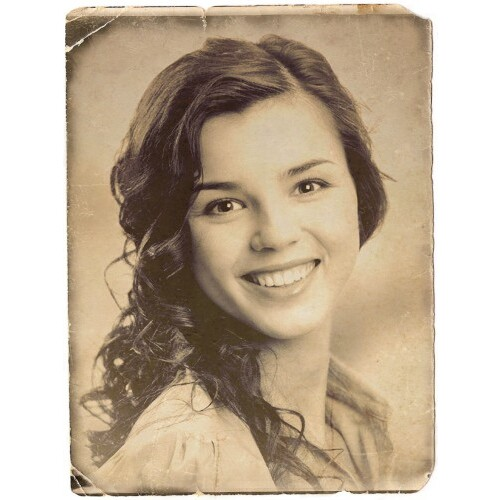

# ✨ Photo Enhancer

Aplicación web para restaurar y mejorar fotografías con modelos de IA. Sube una imagen (retratos, fotos antiguas o de baja resolución) y obtené una versión mejorada, con opción de reparar rayones/arañazos y de mejorar también la calidad del fondo.


## Demo



## Características

- **Mejora de rostros** con [GFPGAN](https://github.com/TencentARC/GFPGAN), un modelo generativo para restauración facial.
- **Mejora de fondo** opcional con [Real-ESRGAN](https://github.com/xinntao/Real-ESRGAN) (super-resolución x2).
- **Reparación de rayones y arañazos** en fotos antiguas, usando [zeroscratches](https://github.com/leonelhs/zeroscratches).
- **Comparador interactivo** con slider para ver el resultado antes/después.
- Descarga de la imagen procesada en formato PNG.

## Stack técnico

| Capa | Tecnología |
|---|---|
| UI / Web app | [Streamlit](https://streamlit.io/) |
| Visión por computadora | OpenCV, Pillow, NumPy |
| Modelos de IA | PyTorch, GFPGAN, Real-ESRGAN, BasicSR, FaceXLib |

## Estructura del proyecto

```
photo-enhancer/
├── app.py              # Punto de entrada de la app Streamlit
├── config.py           # Configuración de la página y de los modelos
├── src/
│   ├── models.py        # Lógica de carga e inferencia de los modelos de IA
│   ├── ui.py             # Componentes de interfaz (uploader, slider, botones)
│   └── utils.py          # Conversión de formatos de imagen (PIL <-> OpenCV)
├── requirements.txt
└── LICENSE
```

## Instalación

Requiere Python 3.10 (versión con la que se probaron las dependencias de PyTorch/GFPGAN).

```bash
git clone <url-del-repo>
cd photo-enhancer

python3.10 -m venv venv
source venv/bin/activate  # En Windows: venv\Scripts\activate

pip install -r requirements.txt
```

> Los pesos de los modelos (GFPGAN, Real-ESRGAN) se descargan automáticamente en el primer uso y no están incluidos en el repositorio.

## Uso

```bash
streamlit run app.py
```

Esto abre la app en `http://localhost:8501`. Desde ahí:

1. Subí una foto.
2. Elegí si querés reparar rayones y/o mejorar el fondo.
3. Hacé clic en "Mejorar Calidad".
4. Compará el resultado con el slider interactivo y descargá la imagen.

## Posibles mejoras

- Agregar tests automáticos para las funciones de conversión de imagen (`src/utils.py`).
- Soporte para procesamiento por lotes (varias imágenes a la vez).
- Despliegue en Streamlit Community Cloud o Hugging Face Spaces.

## Licencia

Este proyecto está bajo la licencia MIT. Ver [LICENSE](LICENSE) para más detalles.
